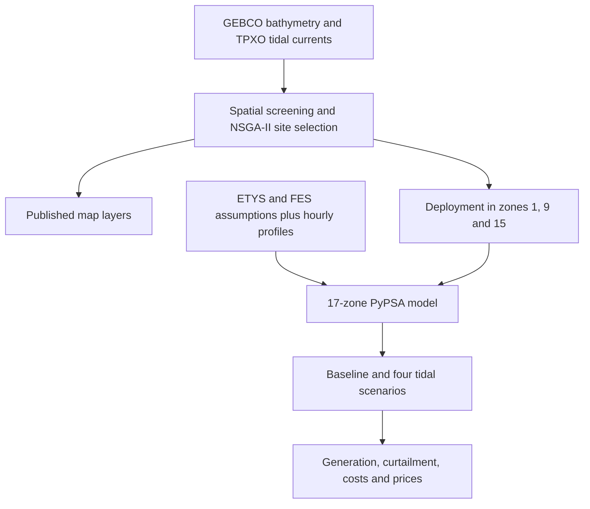
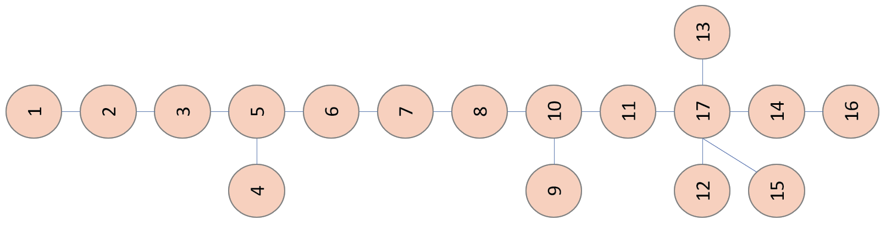

# Tidal stream generation in Great Britain

Research materials for **“An integrated framework for evaluating tidal stream generation potential and its power system benefits: evidence from Great Britain”**, submitted to *Energy*.

**Daniil Hulak, Marko Aunedi, Sobhan Naderian and Gareth Taylor** · Brunel Interdisciplinary Power Systems Research Centre

The study connects geospatial screening and NSGA-II site selection with hourly operation of a **17-zone, 2030 GB electricity system**. Tidal deployment is compared with a baseline by substituting wind and solar PV capacity.

## Start here

| To… | Open… |
| --- | --- |
| Explore tidal sites and ETYS boundaries | [Interactive research map](https://danielckua.github.io/gb-tidal-energy/?v=20261012-default-layers) |
| Run a power-system scenario | [Five PyPSA notebooks and setup guide](stage2_pypsa/) |
| Inspect the original hourly results | [Download CPLEX results ZIP](initial_results/GB_tidal_CPLEX_reference_results.zip) · [Guide](initial_results/) |
| Compare the five scenarios without a solver | [Verified summary](initial_results/scenario_summary.csv) · [Summary command](initial_results/README.md#summarise-without-a-solver) |
| Understand the sources and paper/code differences | [Reproducibility notes](docs/reproducibility.md) |

## Research workflow

This diagram describes the study. The repository supplies the Stage 1 **map export**, Stage 2 **model notebooks and processed inputs**, and **reference outputs**. Raw spatial datasets and scripts for regenerating the Stage 1 screening and optimisation are not included.

## The GB system

Figure 5 panels from the submitted manuscript. [Selected paper figures and captions](docs/figures/README.md) also include the scenario and market results.

## Deployment scenarios

| Scenario | Additional tidal stream capacity | Notebook |
| --- | --- | --- |
| Baseline | 0 MW | [Scenario 0](stage2_pypsa/scenario_0.ipynb) |
| Tidal zone 1 | 500 MW in zone 1 | [Scenario 1](stage2_pypsa/scenario_1_z1.ipynb) |
| Tidal zone 9 | 500 MW in zone 9 | [Scenario 2](stage2_pypsa/scenario_2_z9.ipynb) |
| Tidal zone 15 | 500 MW in zone 15; some wind substitution in zone 12 | [Scenario 3](stage2_pypsa/scenario_3_z15.ipynb) |
| Tidal zones 1, 9, 15 | 500 MW in each zone; 1,500 MW in total | [Scenario 4](stage2_pypsa/scenario_4_all.ipynb) |

The model baseline contains **597 MW of tidal capacity** from the 2030 portfolio. These scenarios add capacity to that baseline; it is not a zero-tidal case. The exact wind/PV substitutions are listed in the [model guide](stage2_pypsa/README.md#capacity-substitutions).

The archived results yield **£64.97 million/year lower operating cost** and **0.578 TWh/year more dispatched wind, PV and tidal energy** in the combined scenario. Some manuscript labels and curtailment figures need reconciliation with the supplied files; see the [consistency check](docs/reproducibility.md#consistency-with-the-submitted-paper).

## Reuse and citation

The paper results were solved with **IBM ILOG CPLEX**. The notebooks offer **HiGHS** for open-source reruns. A solver change or a different dependency environment may change the dispatch and prices; the original outputs remain in a single ZIP, separate from new runs.

The paper is submitted to *Energy*; a publication DOI is not yet provided. GitHub's **Cite this repository** button uses [CITATION.cff](CITATION.cff). See [sources, attribution and validation](docs/reproducibility.md) before reusing the materials. The map retains **© OpenStreetMap contributors** attribution.
