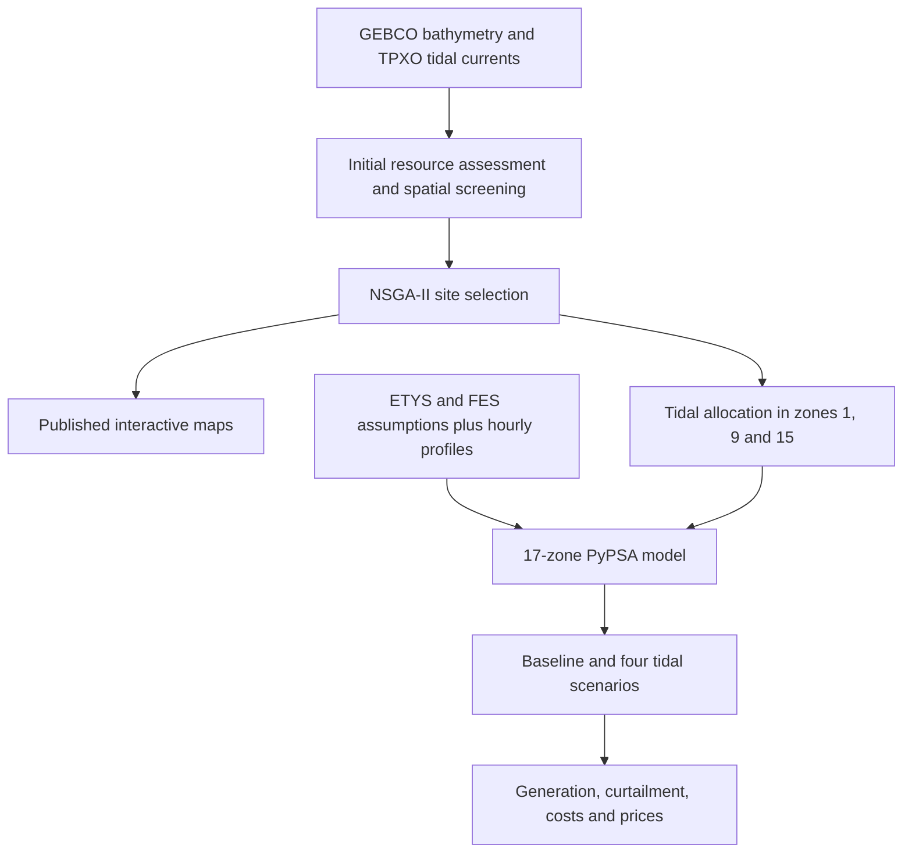

# Tidal stream generation in Great Britain

Research materials for **“An integrated framework for evaluating tidal stream generation potential and its power system benefits: evidence from Great Britain”**, submitted to *Energy*.

**Daniil Hulak, Marko Aunedi, Sobhan Naderian and Gareth Taylor** · Brunel Interdisciplinary Power Systems Research Centre

The study combines geospatial resource assessment and NSGA-II site selection with a **17-zone model of the 2030 GB electricity system** to evaluate tidal stream deployment and its power-system benefits.

## Start here

| Section | Materials |
| --- | --- |
| Stage 1 — resource assessment and site selection | [Interactive research map](https://danielckua.github.io/gb-tidal-energy/?v=20261012-default-layers) · [Map guide](stage1_maps/) |
| Stage 2 — power-system modelling | [Five PyPSA notebooks, inputs and setup](stage2_pypsa/) |
| Original simulation results | [Download CPLEX results ZIP](initial_results/GB_tidal_CPLEX_reference_results.zip) · [Results guide](initial_results/) |
| Research figures | [System representation and results figures](docs/figures/) |
| Data sources and software | [Sources and reproduction guide](docs/reproducibility.md) |

## Research workflow

## Stage 1 — resource assessment and site selection

GEBCO bathymetry and TPXO tidal-current data are processed in QGIS to screen potential tidal stream locations. NSGA-II identifies trade-offs between current speeds, distance to shore and water depth. The two depth ranges are **30–50 m** and **35–45 m**, with **40 m** as the reference depth.

**[Explore the interactive QGIS maps](https://danielckua.github.io/gb-tidal-energy/?v=20261012-default-layers)** to compare screening layers and Pareto-optimal sites around Orkney/Pentland Firth, Anglesey/North Wales and the Bristol Channel. Open **Layers** to choose research overlays; OpenStreetMap and ETYS boundaries are enabled by default. See the [map guide](stage1_maps/) for layer descriptions and local use.

## Stage 2 — the GB power system

The selected deployment zones are assessed in a **17-zone, 2030 GB model** built in PyPSA using ETYS and FES assumptions and hourly demand and generation profiles. The model represents generation, storage and inter-zonal transmission constraints.

  
  

Figure 5: GB zonal system map (left) and simplified network topology (right). The topology is displayed vertically, as in the paper. See [selected research figures](docs/figures/) for the scenario impacts and zonal market metrics.

### Deployment scenarios

| Scenario | Additional tidal stream capacity | Notebook |
| --- | --- | --- |
| Baseline | No additional deployment | [Scenario 0](stage2_pypsa/scenario_0.ipynb) |
| Tidal zone 1 | 500 MW in zone 1 | [Scenario 1](stage2_pypsa/scenario_1_z1.ipynb) |
| Tidal zone 9 | 500 MW in zone 9 | [Scenario 2](stage2_pypsa/scenario_2_z9.ipynb) |
| Tidal zone 15 | 500 MW in zone 15; supporting RES substitution in zone 12 | [Scenario 3](stage2_pypsa/scenario_3_z15.ipynb) |
| Tidal zones 1, 9, 15 | 500 MW in each zone; 1,500 MW in total | [Scenario 4](stage2_pypsa/scenario_4_all.ipynb) |

Tidal capacity additions replace portions of wind and solar PV capacity. The baseline includes the 2030 portfolio's **597 MW of tidal capacity**. The [Stage 2 guide](stage2_pypsa/) provides setup, model assumptions and output descriptions. Original hourly results are available as a [single CPLEX ZIP](initial_results/GB_tidal_CPLEX_reference_results.zip).

## Reuse and citation

The reference simulations used **IBM ILOG CPLEX**. The notebooks also offer **HiGHS** for open-source reruns. New runs are saved separately from the original archive.

The paper is submitted to *Energy*. Its final citation, DOI and downloadable BibTeX/RIS files will be added after publication. Until then, the title and authors above identify the associated study.

See [data sources and reproduction](docs/reproducibility.md) for package coverage and attribution. The interactive maps retain **© OpenStreetMap contributors** credit.
