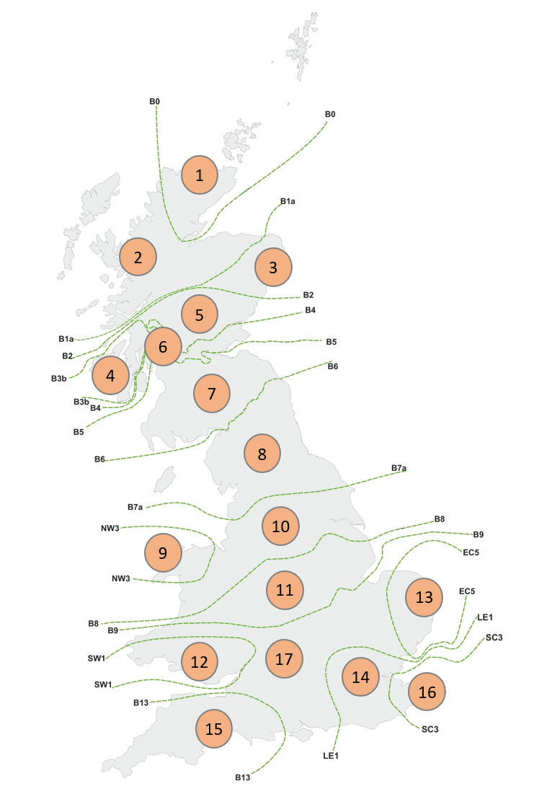
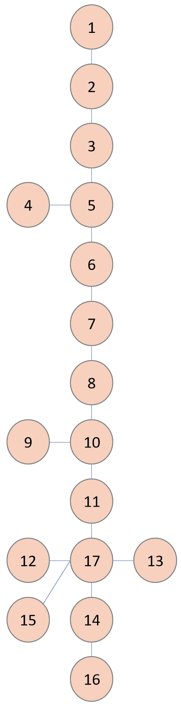
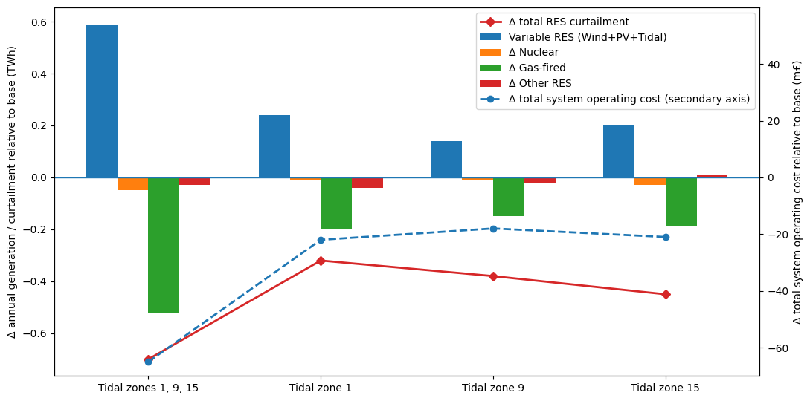
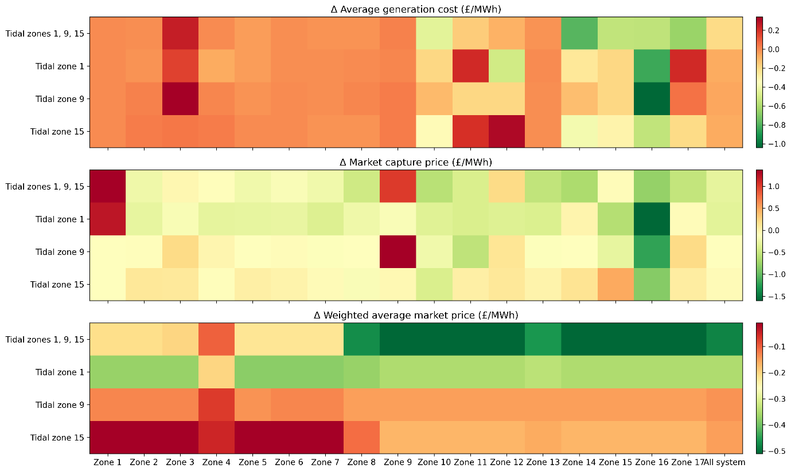

# Research figures

Selected figures from **“An integrated framework for evaluating tidal stream generation potential and its power system benefits: evidence from Great Britain”**, by Daniil Hulak, Marko Aunedi, Sobhan Naderian and Gareth Taylor, submitted to *Energy*.

## Figure 5 — GB system representation

  
  

The left panel shows the 17 ETYS-aligned electricity zones; the right panel shows the simplified connections used in the PyPSA model. Both panels are from Figure 5. The original topology image is displayed with a 90° rotation to restore its vertical orientation and upright labels.

## Figure 11 — scenario impacts

The figure compares tidal deployment scenarios with the baseline. Bars show changes in annual generation by technology group; the solid red line shows the change in RES curtailment. The dashed blue line uses the secondary axis to show the change in total system operating cost. Negative cost changes indicate savings relative to the baseline.

## Figure 12 — zonal market metrics

The three heatmaps show changes relative to the baseline in **average generation cost** (top), **market capture price for the RES mix** (middle), and **demand-weighted average market price** (bottom), all in £/MWh. Rows represent tidal deployment scenarios; columns represent the 17 zones and the whole system. Capture price is the electricity price weighted by renewable generation; the weighted market price uses electricity demand as its weight. Negative values mean a lower value than in the baseline; a lower capture price also means lower revenue per MWh for generators.

These are the paper's figures, not newly calculated results. See the paper for their full definitions and discussion.
